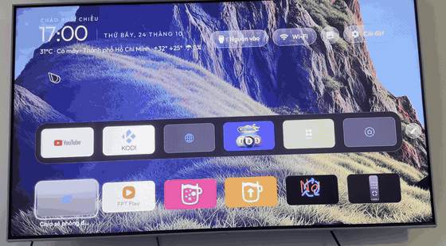
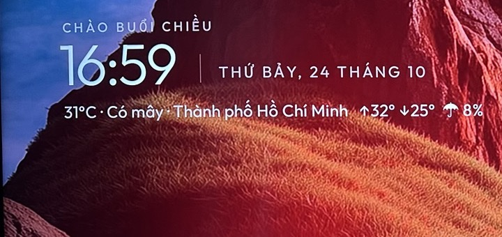
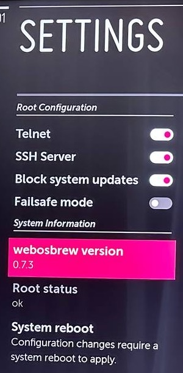

<div align="center">

# LG TV Vibehack

**An Apple TV–style home screen for LG webOS TVs, with a real Home button, weather and your own wallpaper.**

*LG TV-vibehack · webOS-vibehack · LG-vibehack: a webOS launcher that replaces LG's ad-filled home.*

[](https://github.com/hoangvya19/lg-tv-webos-vibehack/releases)
[](LICENSE)
[](#tested-tvs)
[](#root-or-no-root)

**English** · [Tiếng Việt](README.vi.md)


</div>

---

## Contents

- [Features](#features)
- [Root or no root?](#root-or-no-root)
- [Install on a rooted TV (recommended)](#install-on-a-rooted-tv-recommended)
- [Install without root](#install-without-root)
- [Customise: wallpaper, weather, language](#customise-wallpaper-weather-language)
- [Get more apps from the Homebrew Channel](#get-more-apps-from-the-homebrew-channel)
- [Troubleshooting](#troubleshooting)
- [Uninstall](#uninstall)
- [Tested TVs](#tested-tvs)
- [Credits](#credits)
- [Support](#support)

## Features

- **Clean tvOS-style home:** a pinned dock, an app grid and one glass highlight that glides between tiles.
- **Real Home button** (rooted TVs): the remote's Home key opens this launcher, not LG's home.
- **Change the wallpaper from your phone** (rooted TVs): press the picture button, scan the QR code,
  pick a photo and crop it in a TV-shaped frame that shows where the clock and apps will sit.
  Photos on a USB stick in the TV work too.
- **Weather** for your city, free with no account ([Open-Meteo](https://open-meteo.com)).
  Change the city from the same phone page, Vietnamese names with accents included.
- **English or Vietnamese**, 12 h or 24 h clock.
- **4 to 10 tiles per row:** press the pencil next to the dock and pick a number.
- **Opens by itself when the TV turns on** (rooted TVs), even if the TV starts on Live TV.
- **Apps stay in sync by themselves** (rooted TVs): install or remove an app and the launcher updates at the next boot.
- **Rearrange tiles** the easy way: pencil next to the dock → **Rearrange apps**, then click an app,
  point where it should go and click again. Or hold OK on a tile (works with the pointer and the arrows).
- **No tracking, no ads, no account.** Plain HTML, CSS and JavaScript.

<p align="center">
  
  
</p>

## Root or no root?

Both work. **Root gives a much better result**, because webOS only lets privileged apps change
the Home button or start things at boot.

| | Rooted TV | No root (Developer Mode) |
|---|:---:|:---:|
| Launcher with dock, grid and glass highlight | ✅ | ✅ |
| Wallpaper, weather, language, clock, columns | ✅ | ✅ |
| Change wallpaper and weather city **from your phone** (QR code) | ✅ | ❌ edit `config.js` |
| Install with **one command**, no computer needed | ✅ | ❌ needs a computer |
| **Home button** opens the launcher | ✅ | ❌ (number-key shortcut instead) |
| Opens by itself after turning the TV on | ✅ | ❌ |
| App list updates by itself | ✅ | ❌ re-run the installer |
| Keeps working forever | ✅ | ⚠️ Developer Mode expires, renew it in the app |
| Block LG ads and tracking (with *Life's Good Without Spying*) | ✅ | ❌ |
| Risk to the TV | Low | None |

Not sure if your TV can be rooted? Check **[rootmy.tv](https://rootmy.tv)** and the
**[webOS Homebrew rooting guide](https://www.webosbrew.org/rooting/)**. It depends on your firmware.

## Install on a rooted TV (recommended)

**You need:** a rooted LG TV with the **Homebrew Channel**, and a phone or computer on the same Wi-Fi.

### 1. Turn on SSH (one time)

On the TV, open **Homebrew Channel → Settings (⚙)** and turn on:

- **SSH Server**
- **Block system updates** (an LG update can remove root)

Check that **Root status** says **ok**, then press **System reboot**.



Find the TV's IP address: **Settings → Network → (Wi-Fi or Wired) → Advanced**. It looks like `192.168.1.50`.

### 2. (Optional) Install LG Input Hook

For the **Home button** to open the launcher, install **LG Input Hook** from the Homebrew Channel
and open it once. You can skip this; the installer works without it, but then Home briefly shows
LG's home before switching to the launcher.

### 3. Run one command

Open a terminal:

- **Windows 10/11:** press Start, type `Terminal` (or `PowerShell`), press Enter.
- **Mac:** press ⌘ + Space, type `Terminal`, press Enter.
- **Phone:** any SSH app (e.g. Termius).

Connect to the TV (use your TV's IP). The password is `alpine`:

```bash
ssh root@192.168.1.50
```

Then paste this and press Enter:

```bash
curl -fsSL https://raw.githubusercontent.com/hoangvya19/lg-tv-webos-vibehack/main/install.sh | sh
```

When it says **Done**, type `reboot`. That's it. 🎉

<details>
<summary><b>Same thing, with wallpaper, weather and Vietnamese in one go</b></summary>

```bash
curl -fsSL https://raw.githubusercontent.com/hoangvya19/lg-tv-webos-vibehack/main/install.sh | sh -s -- \
  --city "Hanoi" --wallpaper https://example.com/my-photo.jpg --lang vi --clock24 on
```

All options are in [Customise](#customise-wallpaper-weather-language).
</details>

> **Security tip:** the root password `alpine` cannot be changed on webOS (the system is read-only).
> Use an SSH key instead, as the TV's own login message recommends: run `ssh-copy-id root@192.168.1.50`
> on your computer once. Also turn **Telnet off** in the Homebrew Channel settings: it gives a root
> shell with no password to anyone on your network.

## Install without root

**You need:** a Mac or Linux computer with [Node.js](https://nodejs.org) and [Python 3](https://www.python.org/downloads/),
on the same network as the TV. (Windows: use [WSL](https://learn.microsoft.com/windows/wsl/install).)

1. **Turn on Developer Mode.** Create a free account at [webostv.developer.lge.com](https://webostv.developer.lge.com).
   On the TV, install **Developer Mode** from the LG Content Store, sign in, turn on **Dev Mode Status**
   (the TV restarts), open it again and turn on **Key Server**.
2. **Download this project:** [Download ZIP](https://github.com/hoangvya19/lg-tv-webos-vibehack/archive/refs/heads/main.zip) and unzip it.
3. **Run the installer** in a terminal inside the unzipped folder:
   ```bash
   ./install-noroot.sh
   ```
   It asks for the TV's IP and the passphrase shown in the Developer Mode app, then installs.
   Accept the prompt that appears on the TV.
4. **Make a shortcut:** while the launcher is open, hold a number key (e.g. **1**) on the remote.
   From then on, holding 1 opens the launcher.

Run `./install-noroot.sh` again whenever you add or remove apps. Developer Mode expires after a
while: open the Developer Mode app and press **Extend** now and then.

<details>
<summary><b>Optional: make the Home button work without root</b></summary>

Keep a computer, Raspberry Pi or NAS running on the same network:

```bash
python3 home-watch.py 192.168.1.50
```

It watches the TV and switches from LG's home back to the launcher in about 0.1 s.
On a Mac: `TV_HOST=192.168.1.50 ./home-watch-mac.sh`.
</details>

## Customise: wallpaper, weather, language

### Rooted TV

**Easiest: from your phone.** On the launcher, go up to the picture button (between the network
button and Settings) and press OK. Scan the QR code with your phone camera (the phone must be on the
same Wi-Fi as the TV). The page that opens lets you:

- **Choose a photo** from the phone, then drag and pinch it inside a 16:9 frame. The grid and dashed
  boxes show where the clock, the buttons and the apps will cover the picture.
- **Darken** the wallpaper, or **remove** it.
- Pick a photo **from a USB stick** plugged into the TV.
- Set the **weather city**: type a name (accents are fine, e.g. "Đà Lạt"), tap the right result.

The QR code contains a private key, so other people on your Wi-Fi can't open the page without it.

**Tiles per row:** on the dock, press Right past the last app to reach the pencil, press OK and pick
4 to 10. This choice is kept on the TV and wins over `--columns`.

**From the command line:** run the same command again with the options you want. Your settings
are kept between runs.

```bash
curl -fsSL https://raw.githubusercontent.com/hoangvya19/lg-tv-webos-vibehack/main/install.sh | sh -s -- --city "London"
```

| Option | What it does |
|---|---|
| `--wallpaper URL` | Background picture from a web link |
| `--wallpaper /tmp/usb/sda/sda1/photo.jpg` | …or from a USB stick plugged into the TV |
| `--no-wallpaper` | Back to plain black |
| `--dim 0.5` | Darken the wallpaper (0 = none, 0.8 = very dark). Default 0.35 |
| `--glow off` | Turn off the coloured glow behind the focused app |
| `--city "Ho Chi Minh City"` | Weather for this city |
| `--fahrenheit` | Weather in °F |
| `--no-weather` | Hide the weather |
| `--lang vi` / `--lang en` | Vietnamese or English |
| `--clock24 on` | 24-hour clock |
| `--columns 6` | Tiles per row, 3 to 10 (the pencil on the TV overrides it) |
| `--no-home-button` | Leave the remote's Home button alone |

**Wallpaper tips:** a landscape photo works best (1920 × 1080). Keep faces in the upper third:
the dock and the app grid cover the lower half.

**Custom app icons:** put a PNG named after the app ID in `/home/root/lg-tv-vibehack/icons/`
(e.g. `netflix.png`) and reboot. Nice transparent logos: [Dashboard Icons](https://github.com/homarr-labs/dashboard-icons).
List app IDs with `node /home/root/lg-tv-vibehack/sync.js --list`.

### No root

Edit `app/config.js` (it is commented line by line), then run `./install-noroot.sh` again.
For a wallpaper, save the picture as `app/bg.jpg` and set `wallpaper: 'bg.jpg'`.
For weather, set `enabled: true` and your coordinates (in Google Maps, long-press your home:
the two numbers are latitude and longitude).

## Get more apps from the Homebrew Channel

Open the **Homebrew Channel**, pick an app, press **Install**. The launcher picks it up after the next reboot.

| App | What it's for | Root |
|---|---|:---:|
| **Kodi** | Play videos from USB, your network or add-ons | No |
| **Jellyfin** | Watch your own movie library from a PC/NAS running Jellyfin | No |
| **PlxNative** | Fast Plex client (the official Plex app is also in the LG Content Store) | No |
| **Moonlight** | Stream games from your PC with low latency | No |
| **YouTube AdFree** | YouTube without ads, with SponsorBlock. Uninstall the official YouTube app first | No |
| **Life's Good Without Spying** | Blocks LG's ads, ACR tracking and telemetry | Yes |
| **LG Input Hook** | Remaps remote buttons (used here for the Home button) | Yes |

**Stremio** is not in the Homebrew Channel. Check the **LG Content Store**; availability depends on
your country and TV model.

To update a Homebrew app, open it in the Homebrew Channel and press **Update**. The channel follows
its own repository, which can lag a little behind the app's GitHub releases.

## Troubleshooting

<details>
<summary><b>The app grid is empty or black</b></summary>

Rooted: run `node /home/root/lg-tv-vibehack/sync.js` over SSH, then reopen the launcher.
No root: run `./install-noroot.sh` again.
</details>

<details>
<summary><b>Home still opens LG's home</b></summary>

1. Is **LG Input Hook** installed and opened once? Run the installer again after installing it.
2. Reboot the TV once after installing.
3. Check the watcher: `ps -ef | grep homewatch` should show a `node` process.
4. Log: `tail -30 /tmp/lg-tv-vibehack.log`
</details>

<details>
<summary><b>At power-on I see Live TV or LG's home for a few seconds first</b></summary>

Normal. webOS starts its own screen first; the launcher takes over as soon as webOS is ready
(usually a few seconds, longer if an LG pop-up such as a software update notice is showing).
</details>

<details>
<summary><b>Home does nothing at all</b></summary>

LG Input Hook caught the key but the command failed. Check:
`cat /home/root/.config/lginputhook/keybinds.json`. It should contain
`/home/root/lg-tv-vibehack/golauncher.sh`. Run the installer again to fix it.
</details>

<details>
<summary><b>The picture button says the wallpaper page is not running</b></summary>

The page starts about 30 seconds after the TV turns on; wait a moment and try again. Still failing:
`ps -ef | grep wallpaper-server` should show a `node` process, and `tail -30 /tmp/lg-tv-vibehack.log`
shows why. Running the installer again restarts it.
</details>

<details>
<summary><b>The phone can't open the QR code page</b></summary>

The phone must be on the same network as the TV (not on mobile data). If the TV's address changed,
press the picture button again for a new QR code. Tip: reserve the TV's IP address in your router.
</details>

<details>
<summary><b>"Could not download…" or the weather does not show</b></summary>

The TV can't reach the internet. Test on the TV: `curl -sI https://github.com`.
</details>

<details>
<summary><b>It takes 2–3 seconds to come back after YouTube or Netflix</b></summary>

Normal on TVs with less memory: big apps push the launcher out of memory, so it reloads.
</details>

<details>
<summary><b>An app I removed still shows</b></summary>

Rooted: it disappears after the next reboot (or run `sync.js`). No root: run the installer again.
</details>

Still stuck? [Open an issue](https://github.com/hoangvya19/lg-tv-webos-vibehack/issues/new/choose)
with your TV model, a photo of the screen and the log.

## Uninstall

**Rooted:**
```bash
curl -fsSL https://raw.githubusercontent.com/hoangvya19/lg-tv-webos-vibehack/main/install.sh | sh -s -- --uninstall
reboot
```

**No root:** on the TV, open the app list, select **Home**, and delete it.

## Tested TVs

| Model | webOS | Mode | Status |
|---|---|---|---|
| 55NANO77TPA | 6 (firmware 03.51.15) | Root | ✅ |
| OLED55C6XLA | 26 | No root | ✅ |

Tested yours? Open an issue or a pull request to add it here.

## How it works

<details>
<summary>For developers</summary>

- `app/`: the launcher, a webOS web app (HTML/CSS/ES5 JavaScript, works on Chromium 79 / webOS 6).
- `tv/sync.js`: runs on rooted TVs. Reads apps with `luna://com.webos.applicationManager/listLaunchPoints`
  and inputs with `luna://com.webos.service.eim/getAllInputStatus`, copies icons into the installed app,
  and writes `apps.js` + `user.js` (your settings).
- `tv/homewatch.js`: subscribes to `getForegroundAppInfo` and brings the launcher back when LG's home
  appears (backup for TVs without LG Input Hook). For 90 s after webOS is ready it does the same for
  Live TV, which is what most TVs open at power-on.
- `tv/wallpaper-server.js` + `tv/wallpaper.html`: a small web server on port 8090 for the phone page
  (wallpaper, crop, dim, weather city). Web apps on webOS 6 can't make HTTP calls to the TV itself,
  so it writes its address to `wall.js` in the app folder (for the QR code) and relaunches the
  launcher with `{reload: true}` after a change.
- `tv/golauncher.sh`: the command LG Input Hook runs for the Home key (key code 773).
- `tv/boot.sh`: started by the Homebrew Channel from `/var/lib/webosbrew/init.d/` at every boot.
- `install.sh`: the rooted one-command installer. `install-noroot.sh` + `sync-apps.py`: the Developer Mode path.
- Releases are built by GitHub Actions (`.github/workflows/release.yml`) when a `v*` tag is pushed.
</details>

## Credits

This project stands on the work of others. Thank you:

- **[Gathin23/tv-vibehack](https://github.com/Gathin23/tv-vibehack)**: the original Apple TV–style launcher for Android TV.
- **[webOS Homebrew Project](https://www.webosbrew.org)**: Homebrew Channel, root tools and the app repository.
- **[RootMyTV](https://rootmy.tv)**: making root possible on LG TVs.
- **[Simon34545/lginputhook](https://github.com/Simon34545/lginputhook)**: remote button remapping.
- **[Open-Meteo](https://open-meteo.com)**: free weather and geocoding API.
- **[Outfit](https://fonts.google.com/specimen/Outfit)** font (SIL Open Font License).
- Built with help from **[Claude](https://claude.ai)** by Anthropic.

## Support

If this made your TV nicer, a ⭐ on the repo helps others find it.

Want to buy me a coffee? Donations in **USDT on BNB Smart Chain (BEP20)** are welcome:


```
0x11a0cd4c3e0135d2af5dc0ad0d44bc535fe4645b
```

⚠️ Send **USDT on the BNB Smart Chain (BEP20) network only**. Coins sent on another network are lost.

## Disclaimer

Rooting and modifying your TV is at your own risk and may affect your warranty. This project does not
modify system partitions; everything it installs can be removed with `--uninstall`. LG, webOS and all
app names are trademarks of their respective owners. This project is not affiliated with LG Electronics.

## License

[MIT](LICENSE). Includes code from tv-vibehack and webos-vibehack, also MIT.
